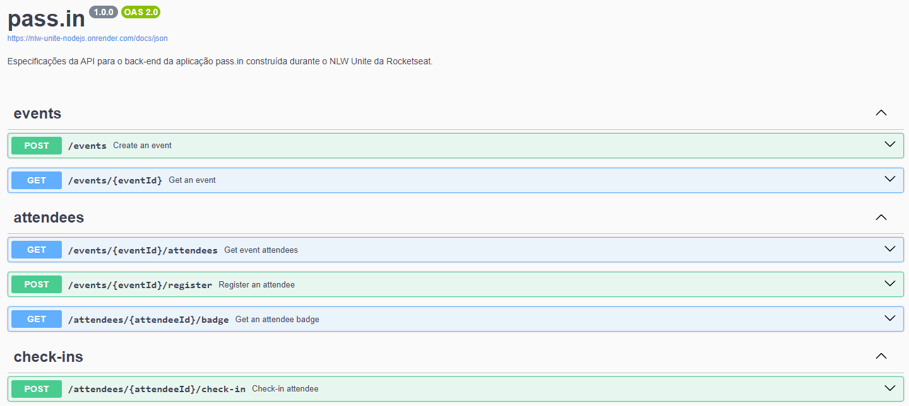

<h1 align="center"> pass.in - NLW Unite 🎟️</h1>

API de gestão de participantes em eventos presenciais, com inscrição, credencial e check-in

  <a href="#-tecnologias">Tecnologias</a>&nbsp;&nbsp;&nbsp;|&nbsp;&nbsp;&nbsp;
  <a href="#-projeto">Projeto</a>

  
 

## 🚀 Tecnologias

Esse projeto foi desenvolvido com as seguintes tecnologias:

- Python
- Flask e Flask-CORS
- SQLAlchemy
- SQLite
- Pytest
- Git e Github

## 💻 Projeto

- O pass.in é uma API para gestão de participantes em eventos presenciais, desenvolvida durante o NLW Unite da Rocketseat. O organizador cadastra um evento com limite de vagas, os participantes se inscrevem, visualizam a credencial de inscrição e fazem check-in no dia do evento, com regras que impedem inscrição duplicada, inscrição em evento lotado e check-in repetido.

- A aplicação segue uma arquitetura em camadas: rotas Flask, handlers com as regras de negócio, repositórios com SQLAlchemy sobre um banco SQLite (schema em `init/`) e tratamento centralizado de erros HTTP (404 e 409). Os repositórios têm testes com Pytest.

<h2 align="center">📌 Desenvolvedores</h2>

<table align="center">
  <tr>
    <td align="center">
      <a href="https://github.com/rebellatoGui" title="GitHub">
         
        
          <b>Guilherme Rebellato</b>
        
      </a>
    </td>
  </tr>
</table>

 

---

Feito com ♥ por rebellatoGui

